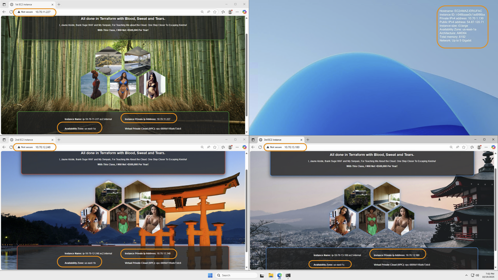
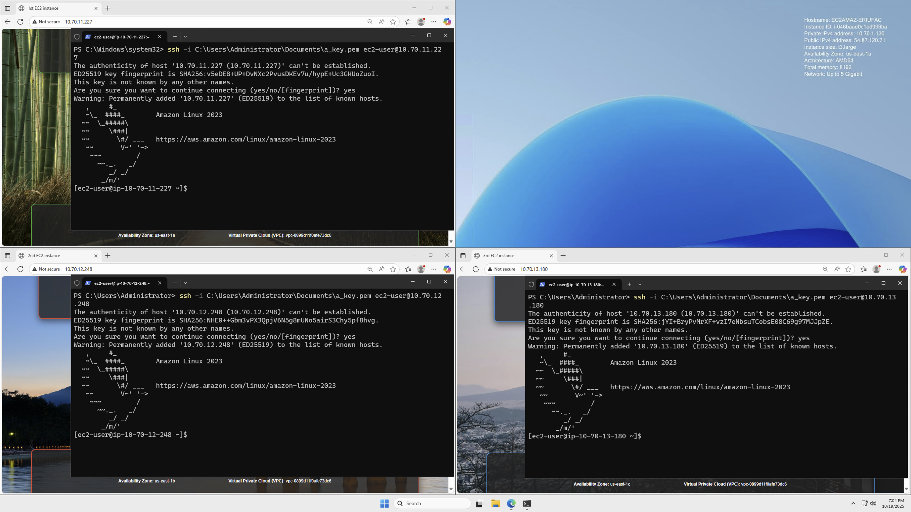

### 1. Three linux instances in 3 different Availability Zones (AZ')s and in three different subnets; each with web servers with different text and backgrounds. AZ's and IPs are highlighted by an orange border.

### 2. Same instances, but showing ssh connection.

